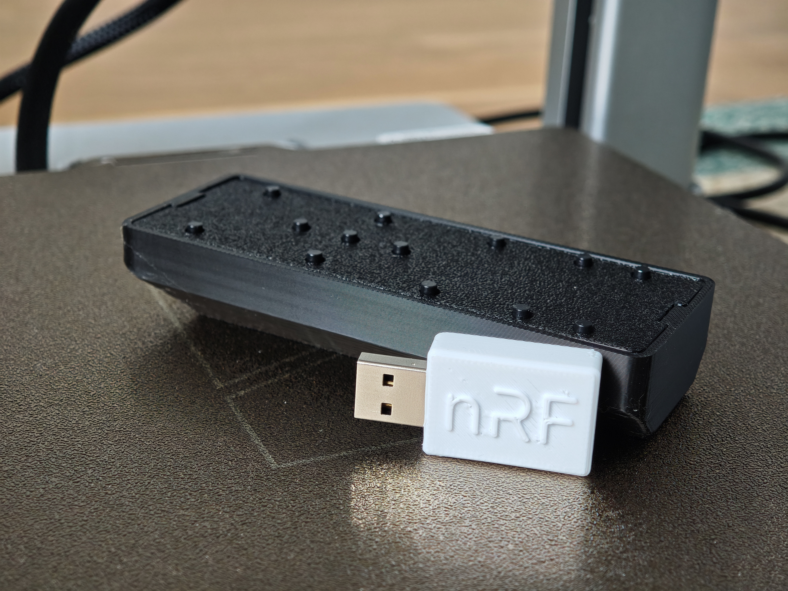

# nRF24-Based Remote Control

A complete 2.4 GHz wireless remote control system. The PCBs and firmware are tested and working. The first PCB revision required soldering external wires for programming — this was fixed with an updated programming header in the current revision.



## Repository Layout

```
Firmware/
  nrf24le1-transmitter/   # Transmitter firmware (SDCC / nRF24LE1)
  nrf52820-receiver/      # Receiver firmware (CMake / nRF52820)
KiCad/
  nrf24le1-transmitter/   # Transmitter PCB design
  nrf52820-receiver/      # Receiver PCB design
```

## Transmitter

The transmitter is based on the **nRF24LE1**, which uses Nordic's proprietary 2.4 GHz **ShockBurst** protocol. This chip operates at **1.9 V – 3.6 V**, making it ideal for **two AAA batteries**.

### Features
- **15 buttons** — two positioned on the PCB sides for experimentation
- **Antenna** — top-mounted PCB trace antenna for improved signal
- **Programming** — SPI + PROG pin, flashable via Arduino; pinout printed on board

See [Firmware/nrf24le1-transmitter/README.md](Firmware/nrf24le1-transmitter/README.md) and [FLASHING_GUIDE.md](Firmware/nrf24le1-transmitter/FLASHING_GUIDE.md).

## Receiver

The receiver is based on the **nRF52820**, the most cost-effective Nordic chip with native **USB HID** support. It is an ARM Cortex-M4 microcontroller programmed over **SWD**.

### Features
- **USB HID** — exposes keyboard and consumer-control interfaces to the host
- **Programming** — TagConnect 6-pin NL connector (SWD)
- **Hardware** — PCB trace antenna and PCB-mount USB 2.0 connector

See [Firmware/nrf52820-receiver/README.md](Firmware/nrf52820-receiver/README.md) and [FLASHING_GUIDE.md](Firmware/nrf52820-receiver/FLASHING_GUIDE.md).

## Status

- [x] Program the remote
- [x] Program the receiver
- [x] Test stability and antenna performance
- [x] Design a 3D-printed case

## Acknowledgements

- [Dean Cording](https://github.com/DeanCording/nRF24LE1_SDK) — nRF24LE1 SDK used by the transmitter firmware
- [polkabana](https://github.com/polkabana/nRF24LE1_Programmer) — nRF24LE1 Programmer utility used for flashing the transmitter
- [greenlsi](https://github.com/greenlsi/nrf5-sdk/) — nRF5 SDK used by the receiver firmware

## Contribution

Contributions are welcome! Please open an issue first to discuss your proposed changes before submitting a pull request.

## Support

If you find this project useful, you can buy me a coffee:

<a href="https://buymeacoffee.com/sini6a"></a>